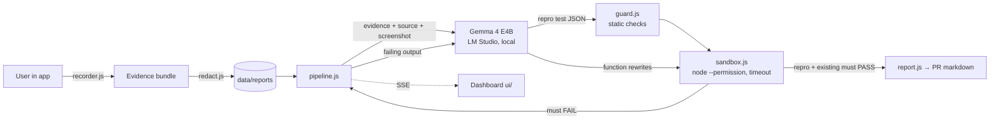

# RedGreen 🔴🟢

[](https://github.com/samvit-srivastava/redgreen/actions/workflows/test.yml)

**Bug report → failing test → verified fix, on local Gemma 4. No proof, no fix.**

AI coding tools are good at *saying* they fixed a bug. RedGreen won't let them until it's proven: a check must **fail on the current code** (🔴 RED), and after Gemma's patch the **same check must pass** with nothing else broken (🟢 GREEN). The verdict comes from real test runs, never from the model.

## Three ways in

| Input | What RedGreen does | The proof |
|---|---|---|
| **A GitHub issue on a website** (plain HTML/CSS/JS, or any repo with `npm run dev` / `npm start`) | Clones the repo, serves the site, takes a screenshot, and **Gemma 4 reads the screenshot** plus the relevant HTML/CSS/JS. Gemma writes **browser steps as data** (click, type, expect text), which RedGreen runs in a real headless Chrome/Edge. | The steps fail on the live site, then pass after the patch. Before/after screenshots. |
| **A GitHub issue on a JavaScript library** (node:test, Vitest, Jest or Mocha) | Clones the repo, installs deps with install scripts **disabled**, finds the relevant files by keyword search (shown on screen), and Gemma writes a test in the repo's own framework. | The new test fails, then passes; the repo's own `npm test` must not get worse. |
| **A bug report from an instrumented app** (the demo shop) | A drop-in recorder captures the user's actions + state, failed requests and console errors, redacted before saving; optional screenshot. | The replayed test fails, then passes, inside a sandbox with Node's permission model. |

Everything runs on a laptop with **Gemma 4 E4B in LM Studio**. Issue text, page content and evidence are treated as untrusted data in every prompt.

## GitHub bot (runs on your laptop, no server needed)

RedGreen can watch your repos (or **your fork** of someone else's project) and answer issues by itself:

1. Create a fine-grained token limited to those repos with **Issues**, **Contents** and **Pull requests** set to read and write.
2. Start it (PowerShell):
   ```powershell
   $env:GITHUB_TOKEN = "<your token>"
   $env:REDGREEN_BOT_REPOS = "you/tiny-shop,you/your-fork"
   npm run dev:github
   ```
3. On a watched repo, add the label **`redgreen`** to an issue, or comment **`/redgreen`**. Only people with write access can trigger it, because it runs the repo's code on your machine.
4. **Fork workflow (Hacktoberfest):** in your fork, comment `/redgreen https://github.com/upstream/project/issues/42`. RedGreen reads the upstream issue and reproduces it against your fork's code. With PRs turned on, it opens a PR on your fork titled `Fix upstream/project#42` plus a one-click link to send it upstream. It never posts on projects you don't control.

**Hosting:** RedGreen runs where the model and a browser can run: your laptop, or any machine with LM Studio. Serverless hosts like Vercel can't clone repos, run test suites or drive Chrome for minutes at a time. The planned hosted version is a GitHub Action that runs on GitHub's own runners and calls Gemma 4 through the Gemini API.

**By default the bot never changes your code.** It replies on the issue with:
- 🔴 **Reproduced**: the failing test or browser steps, with the real output (e.g. expected `$40.00`, got `$20.00`).
- 🔍 **Where to look**: the files involved and the likely cause.
- 🟢 **Suggested fix (verified)**: a diff, shown only if RedGreen ran it and the failing check then passed with the repo's own tests still green. Otherwise it says there is no verified fix yet.

If the bug can't be reproduced it says so, and claims nothing. Set `REDGREEN_BOT_OPEN_PRS=1` to also open a PR for verified fixes (on a fork, with a one-click link to send it upstream). Open dashboards follow bot runs live.

## Choose where Gemma 4 runs

Open **Model settings** (top-right status pill):
- **On this computer:** LM Studio with Gemma 4 E4B. Private and free; nothing leaves the machine.
- **Gemini API:** bring your own key from [Google AI Studio](https://aistudio.google.com/apikey) and use `gemma-4-26b-a4b-it` or `gemma-4-31b-it`. The key is stored only on the server running RedGreen and is never shown again. This is how a deployed RedGreen works.

## Deploy

RedGreen clones repos, runs their tests and drives Chrome, so it needs a real server (Render, Railway, Fly.io, any VM), not a serverless host like Vercel.

- `Dockerfile` (Playwright image with Chromium) and `render.yaml` are included. On Render: New → Blueprint → this repo.
- Set `REDGREEN_PASSWORD` (protects the dashboard; anyone who can open it can make the server run repo code), `GEMINI_API_KEY` (or paste it on the Model page), and `PUBLIC_URL` (needed for one-click GitHub App creation). Without a password, a server that listens beyond localhost keeps GitHub mode, the bot and the settings pages off.
- Health check: `/healthz`.

## Why this is different

| | Typical AI fix tools | RedGreen |
|---|---|---|
| Input | Stack trace or issue text | Captured user session: actions + state, failed requests, console errors, screenshot |
| "Fixed" means | The model said so | The same test went red → green and the existing tests still pass |
| Where it runs | Cloud | Local Gemma 4 via LM Studio, offline |
| Generated code | Often run directly | Static allow-list check, then a sandbox using Node's permission model (no fs writes, no child processes, read-only access to the sandbox dir), 15s timeout, empty env, no shell |

## Where Gemma 4 does the work, and where it doesn't

| Gemma 4 (interpretation) | Deterministic code (facts) |
|---|---|
| Reads messy evidence + screenshot, forms a hypothesis, cites event ids | Recording, redaction, storage |
| Writes the reproduction test | Running tests, deciding red/green, exit codes |
| Proposes the minimal patch (whole-function rewrites) | Applying the patch (existing functions only), diffing, verification |
| Explains the root cause | Building the PR text from real outputs |

## Quick start (Windows / macOS / Linux, Node ≥ 20, no `npm install` needed)

1. **LM Studio** → download **Gemma 4 E4B** (Q4_K_M) → load it → Developer tab → **Start Server** (port 1234).
2. In this folder:
   ```bash
   npm run doctor    # checks Node/sandbox, LM Studio + Gemma, git, ports; prints the fix for anything missing
   npm run smoke     # proves Gemma 4 is reachable and returns structured JSON
   npm start         # RedGreen on http://localhost:3000, demo shop on http://localhost:3000/shop/
   ```
3. **GitHub mode:** paste an issue URL (e.g. one from [tiny-shop](https://github.com/samvit-srivastava/tiny-shop/issues) or [tiny-cart](https://github.com/samvit-srivastava/tiny-cart/issues)) and press **Reproduce and fix**. Website mode needs Chrome or Edge installed (`npm install` adds `playwright-core`, no browser download).
4. **Demo-shop mode:** add Headphones → set qty 3 → apply `SAVE20` → set qty 1 → Checkout (it fails) → **🐞 Report bug**, then open the report in RedGreen.

Config (env vars): `GEMMA_BASE_URL` (default `http://localhost:1234/v1`), `GEMMA_MODEL` (default: auto-detects the loaded Gemma model), `GEMMA_API_KEY`, `GEMMA_TEMPERATURE`, `GEMMA_MAX_TOKENS`, `PORT`.

## Tests

```bash
npm test               # redaction, safety guard, JSON parsing, and a full pipeline run against a mock model
npm run check:sandbox  # proves generated tests can read only the sandbox: no outside reads, no writes, no child processes
npm run eval -- 5      # runs the full pipeline 5× against the REAL local model; prints measured counts + timings, saves data/eval/
```

A verified run's patch (source diff + the repro test as a new file) can be downloaded from `GET /api/runs/<id>/patch.diff` and applied from the repo root with `git apply`.

## Demo app (synthetic)

`fixtures/shop` is a **synthetic demo app with two intentionally planted, independent bugs**. Its 5 existing tests all pass and miss both.

1. The coupon discount is computed once, when the coupon is applied, and isn't recalculated when quantity changes. (Add Headphones → qty 3 → `SAVE20` → qty 1 → Checkout fails.)
2. Applying an invalid coupon silently drops the coupon already applied, while the old discount stays on screen. (Add Headphones → `SAVE20` → `SAVE50` → Checkout fails: client $40.00, server $50.00.)

`data/reports/rpt_sample.json` and `rpt_sample_coupon.json` are **scripted sample** reports, generated by replaying real actions against the real cart module (`npm run sample`, `npm run sample -- coupon`), and are labelled as such in the UI.

## Architecture



```
server.js            zero-dependency HTTP server + SSE
src/model.js         Gemma 4 client (OpenAI-compatible: LM Studio by default)
src/prompts.js       prompts + JSON schemas (evidence treated as untrusted data)
src/pipeline.js      red → green state machine with retry feedback
src/guard.js         allow-list for generated tests, safe function-level patching
src/sandbox.js       isolated test runs
src/redact.js        secret/PII redaction
src/report.js        PR description from real artifacts
ui/                  dashboard
fixtures/shop/       synthetic demo app + recorder.js
```

## Safety & privacy

- **GitHub mode (paste an issue URL) is off by default.** It clones the repo and runs *that repo's* own code: its `npm test`, its test runner, Gemma's patch to its source, and (in Website mode) its `npm run dev` server. For `node:test` repos the reproduction test runs under the permission model (read-only, no writes, no child processes), but the repo's own suite and Jest/Vitest/Mocha runs are **not** sandboxed (they get a temp clone, a timeout, a minimal environment, and dependency install scripts disabled). Enable it only for repos you trust: `npm run start:github` (or set `REDGREEN_ALLOW_REPO_CODE=1`). Issue text is redacted like bug reports.
- **The GitHub bot only acts for accounts you trust.** In GitHub App mode anyone can install the app on their own repos, so RedGreen only runs issues from installations on the app owner's account plus accounts listed in `REDGREEN_BOT_ALLOW` (comma-separated); other installations are logged and ignored. `/redgreen` comments only count from owners, members and collaborators. Everything the bot posts is redacted (tokens, keys, emails) and your home folder / user name are replaced before it reaches GitHub.
- **The local API only answers RedGreen's own pages.** Requests from other websites (cross-site form posts, `` tricks) and foreign `Host` headers (DNS rebinding) are refused, so a page you visit can't plant a bot token or start a run.

- Evidence is redacted (bearer tokens, API keys, JWTs, emails, card-like numbers, secret query params, `Authorization`/`Cookie` headers) **before** it is written to disk or sent to the model.
- Screenshots are attached only if the user chooses one, and are kept locally.
- Evidence is fenced as untrusted data in prompts; the model is told never to follow instructions inside it.
- Model-generated code never runs on the host directly: it goes through an import allow-list, then a temp copy, `node --permission` (read-only access to the sandbox, no child processes, no writes), a 15s timeout, an empty environment and no shell.
- RedGreen never claims a bug is reproduced or fixed unless the corresponding test run actually happened. The verdict comes from exit codes, not from the model.

## Limitations (honest)

- GitHub mode supports public repos: websites (static, or with a `dev`/`start` script that prints a local URL) and JavaScript libraries with node:test, Vitest, Jest or Mocha. Other languages are not supported yet, and the app says so instead of guessing.
- Gemma sees at most a few files chosen by keyword search; bugs that span many files are out of reach for a 4B-class local model.
- Third-party test runners and dev servers run in a temporary clone with timeouts and a minimal environment, not the Node permission sandbox used in demo-shop mode. Browser steps are data, not code.

- Today it targets JavaScript modules tested with `node:test`; the demo uses one fixture app.
- Patches are limited to one file and ≤ 4 rewritten functions (exact find/replace edits, ≤ 6, are still accepted).
- On Node < 22.13 the permission model is unavailable; the UI shows "no fs isolation".
- A small local model can fail to reproduce a bug. RedGreen then says "not reproduced" rather than guessing.

## Roadmap

GitHub issue → RedGreen run → draft PR · Playwright browser-level reproduction · Jest/Vitest/pytest runners · container sandbox.

## License

Apache-2.0
